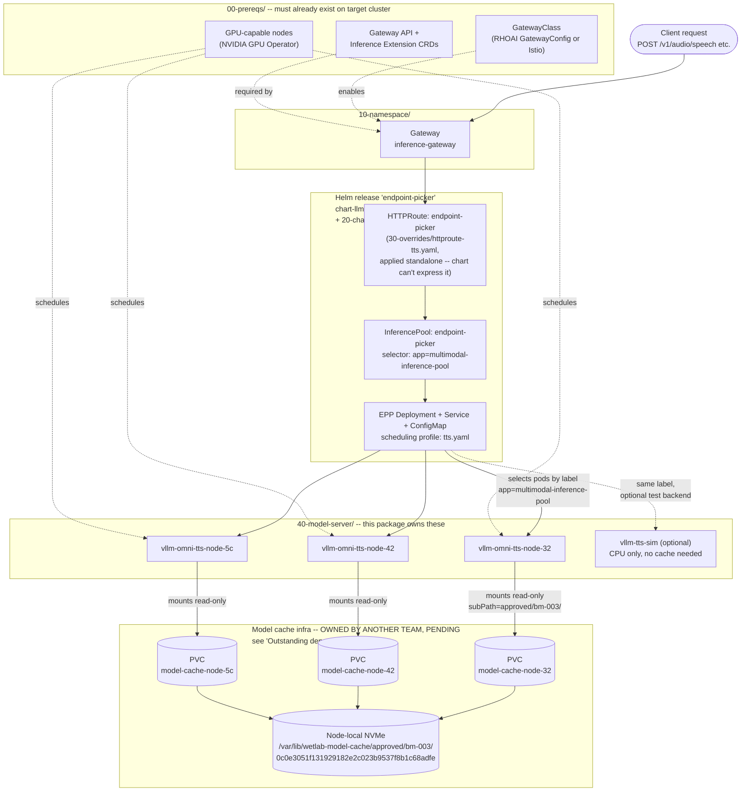

# Transfer Package: vllm-omni on llm-d (WetLab → new cluster)

This package replicates the **llm-d-routed vllm-omni deployment** currently
running on the WetLab cluster (`wetlab-ai` namespace) onto a new cluster.

It was built by reading the actual live cluster state (`oc get ... -o yaml`),
not just the manifests checked into this repo — several pieces had drifted
from what's in git / from a plain `helm install`. See "What's actually
running vs. what's in git" below.

Persistent model cache / PVC **infrastructure** (StorageClass, local PVs,
preload jobs) is being built separately by another team — see "Outstanding
dependency" below for the exact integration contract. **This package does
not work around that by downloading from Hugging Face instead.** The model
server manifests in `40-model-server/` mount the approved node-local cache, the
same way `bm-003-vllm-omni` already does on WetLab — they just won't
actually come up until the other team's cache PVCs exist on the new
cluster.

> **Update:** the same non-compliant behaviour was also found live on
> WetLab itself and has since been fixed there too — `vllm-tts-omni` (the
> HF-downloading Deployment) was deleted and replaced with a third
> cache-mounted, node-pinned backend (`vllm-omni-tts-node-5c`), matching the
> exact pattern this package already uses. WetLab and this package are
> consistent with each other as of this writing.

## Architecture



**Reading the diagram:** a request enters through the `Gateway`, is matched
by the `HTTPRoute` to the `InferencePool`, which delegates the actual
backend-selection decision to the `EPP` (it scores/filters candidate pods
using the `tts.yaml` scheduling profile). The EPP's candidate pool is just
"every pod labeled `app=multimodal-inference-pool`" — that's what makes the
three node-pinned `vllm-omni-tts-node-*` Deployments members of the same
logical backend pool despite each being pinned to a different physical node.
Each one independently mounts *its own* node's PVC, read-only, at the exact
approved BM-003 revision — no cross-node storage, no shared filesystem, no
Hugging Face involved anywhere in this request path.

## What's actually running vs. what's in git

There are **two different vllm-omni deployments** on WetLab today — don't
confuse them:

| | `bm-003-vllm-omni` (in `manifests/wetlab-ai/vllm-omni/bm-003/`) | `vllm-tts-omni` (this package) |
|---|---|---|
| Wired into llm-d routing (Gateway/EPP/InferencePool)? | **No** — standalone Service | **Yes** — this is "vllm-omni on llm-d" |
| Node placement | Pinned to one bare-metal host (`nodeSelector`) | Floats to any GPU node (toleration only) |
| Model source | Node-local PVC (`model-cache-node-32`), read-only, pre-cached | Downloaded from Hugging Face at pod startup |
| In git already? | Yes | **No — only existed live on-cluster**, captured here |

This package replicates the **second** one's *routing integration* (llm-d
Gateway/EPP/InferencePool membership) — using the node-pinned, cache-mounted
model-server pattern (`deployment-vllm-omni-tts-node-{32,42,5c}.yaml`), which
combine:

- the node-pinned, read-only, pinned-revision cache mount pattern from
  `manifests/wetlab-ai/vllm-omni/bm-003/deployment.yaml` (one Deployment per
  cached node, same as `bm-003-vllm-omni` / `bm-003-vllm-omni-42`)
- the llm-d `InferencePool` membership labels from the live `vllm-tts-omni`
  Deployment, so they still register with the Gateway/EPP despite being
  node-pinned

No internet egress needed at startup, and the EPP still load-balances across
however many of the three you scale up — they just need the other team's
model-cache PVCs to exist on each of those nodes first (see "Outstanding
dependency" below). `40-model-server/deployment-vllm-omni-tts.NOT-RECOMMENDED.yaml`
is kept only as an annotated reference copy of the original pattern — `apply.sh`
never applies it.

## Outstanding dependency: model-cache infra (owned by another team)

The three `40-model-server/deployment-vllm-omni-tts-node-*.yaml` manifests
are **complete and correct**, but they reference PVCs that don't exist yet
on the new cluster. Another team is building that infrastructure
(StorageClass, local PVs, per-node PVCs, preload jobs) — tracked separately,
not part of this package. Until it lands, expect these three Deployments to
sit at `Pending`; that's the correct failure mode, not a bug here.

**Integration contract** — what this package currently assumes, so hooking
the two halves together is a find-and-replace, not a redesign:

| This package expects | Currently set to (copied from WetLab) | Lives in |
|---|---|---|
| A `StorageClass` backing node-local PVCs | `wetlab-local-model-cache` (not referenced directly by our manifests, only by the PVC) | n/a — their side |
| One `PersistentVolumeClaim` per GPU node, named `model-cache-node-<id>` | `model-cache-node-32`, `model-cache-node-42`, `model-cache-node-5c` | `claimName:` in each `deployment-vllm-omni-tts-node-*.yaml` |
| Each PVC bound `RWO` to a specific node's local disk | WetLab's three bare-metal hostnames | implied by `nodeSelector.kubernetes.io/hostname` matching the PVC's node |
| Approved BM-003 artifact present under a revision-pinned `subPath` | `approved/bm-003/0c0e3051f131929182e2c023b9537f8b1c68adfe` | `volumeMounts[].subPath` in each deployment |
| Stable in-container mount point | `/models/bm-003` | `volumeMounts[].mountPath` + `--model` arg |

**When they're done, before wiring this up:**

1. Confirm the new cluster's actual GPU node hostnames and swap them into
   `nodeSelector.kubernetes.io/hostname` in each `deployment-vllm-omni-tts-node-*.yaml`
   (currently still WetLab's hostnames: `c0-47-0e-20-70-{32,42,5c}`) — these
   files are named after WetLab's nodes for now, not the new cluster's.
2. Confirm their PVC names match `claimName` in those same files, or update
   `claimName` to match whatever they actually call them.
3. Confirm the revision pinned in their cache (`subPath`) matches the
   Approved Model Catalogue entry for BM-003 — if they onboarded a different
   revision, update `subPath` here to match, don't silently drift.
4. `oc get pvc -n wetlab-ai` should show all three `Bound` before scaling
   any `vllm-omni-tts-node-*` Deployment above `replicas: 0`.

No other part of this package (Gateway, chart, routing) needs to change —
the cache is a leaf dependency of the model-server layer only.

## Pre-flight: other things likely to trip you up on a different cluster

Everything below was checked against the live WetLab cluster / the vendored
chart, not guessed at. Two were real bugs and are already fixed in this
package; the rest are things that can't be fixed in advance because they
depend on the new cluster's hardware/registry access.

**Fixed for you:**

1. **EPP image tag drift (real bug, now fixed).** The live
   `endpoint-picker-epp` Deployment was hand-patched
   (`kubectl-edit`/`kubectl-replace` in its `managedFields`, not `helm`) to
   run `quay.io/rh_et_wd/llm-d-router-endpoint-picker:new-approach`. Our
   captured `values-wetlab-ai.yaml` originally still said `tag: latest` —
   a fresh `helm install` from this package would have installed a
   *different, untested* EPP build. Since the TTS routing profile
   (`40-model-server`'s pods are selected via `tts.yaml`, which uses
   `apiVersion: inference.networking.x-k8s.io/v1alpha1` — a different API
   group than the chart's other default profiles, which use `llm-d.ai/v1alpha1`)
   is the whole point of this deployment, running an EPP build that's never
   been proven against that non-standard config file is exactly the kind of
   thing that "works on WetLab, silently misroutes or crash-loops on the new
   cluster." Fixed: `20-chart/values-wetlab-ai.yaml` now pins `tag:
   new-approach` with a comment explaining why. **If WetLab's EPP image tag
   ever changes, re-check and update this before re-copying the package.**
2. **Unnecessary network dependency removed from `apply.sh`.** It used to
   run `helm dependency build` unconditionally, which refreshes *every* Helm
   repo in your local config (bitnami, gitlab, whatever's cached on your
   machine) — unrelated to this chart, and liable to hang or hard-fail on a
   restricted/air-gapped new-cluster bastion host. The `routerlib` sub-chart
   is already vendored as `chart-llm-d-router-gateway/charts/router-0.0.0.tgz`,
   confirmed to `helm template` successfully with zero network access.
   `apply.sh` now only runs `helm dependency build` if that `.tgz` is
   missing.

**Can't fix in advance — verify these against the new cluster before you scale anything up:**

3. **Release name ↔ InferencePool name ↔ HTTPRoute coupling is fragile.**
   `apply.sh` installs the chart as `helm upgrade --install endpoint-picker
   ...`. The chart derives the `InferencePool`'s `metadata.name` from
   `{{ .Release.Name }}` (confirmed via `helm template` — renders as
   `name: endpoint-picker`), and `30-overrides/httproute-tts.yaml` hardcodes
   `backendRefs[].name: endpoint-picker` to match. **If you ever change the
   release name in `apply.sh`, you must update the `backendRefs[].name` in
   `30-overrides/httproute-tts.yaml` to match**, or the HTTPRoute will apply
   cleanly but silently point at a `InferencePool` that doesn't exist
   (`oc get httproute -o yaml` will show a `ResolvedRefs: False` condition —
   easy to miss if you don't check it).
4. **Namespace name (`wetlab-ai`) is hardcoded, not parameterized.** It
   appears literally in every manifest's `metadata.namespace`, in `apply.sh`'s
   `-n wetlab-ai` flags, and in the README's verify commands. If the new
   cluster wants a different namespace, `grep -rl wetlab-ai .` from this
   directory and update everything it finds — there's no single place to
   change it.
5. **GPU resource requests/limits and `--max-model-len` are tuned for
   WetLab's hardware, not generic.** `40-model-server/deployment-vllm-omni-tts-node-*.yaml`
   request `cpu: "2"`/limit `"8"`, `memory: 8Gi`/limit `16Gi`,
   `nvidia.com/gpu: "1"` (request and limit), and pass `--max-model-len
   4000` — all tuned against WetLab's ~16GB RTX 4090 Laptop GPUs. If the new
   cluster's GPUs have less VRAM, `--max-model-len 4000` could OOM; if they
   have more, you're leaving performance on the table. Re-tune per the new
   hardware, don't copy these numbers assuming they're generic.
6. **Local-PV `nodeAffinity` must match `nodeSelector` hostnames exactly.**
   Already called out in the integration-dependency section above, but worth
   repeating here since it's the single easiest way for this to silently
   half-work: the `StorageClass` is `WaitForFirstConsumer`, so a PVC can sit
   `Pending` indefinitely with no error until a pod that references it is
   actually scheduled — and if the PV's `nodeAffinity` rule (set by the other
   team when they create it) doesn't match the exact hostname in this
   package's `nodeSelector.kubernetes.io/hostname`, the pod will then sit
   `Pending` too, with a scheduling-failure event that's easy to miss if
   you're only watching `oc get pods`.

**Checked and confirmed fine (no action needed, documented so you don't have to re-check):**

- The Gateway API Inference Extension `v1.5.0` CRD release does include the
  GA `inference.networking.k8s.io/v1` `InferencePool` CRD the chart templates
  require (confirmed by pulling the release manifest directly) — no
  CRD-version mismatch risk from the prereqs pin.
- `quay.io/rh_et_wd/llm-d-router-endpoint-picker` is a **public** Quay repo
  (confirmed via unauthenticated manifest pull + the Quay API reporting
  `is_public: true`) — no image-pull secret needed on the new cluster for
  the EPP image. The orphaned `vllm-omni-dev-pull` secret seen live on
  WetLab isn't referenced by any ServiceAccount's `imagePullSecrets`, so it
  isn't actually load-bearing for anything in this package either.

## Directory layout

```text
00-prereqs/             Things the new cluster needs before anything else (read this first)
10-namespace/            Gateway object + optional NetworkPolicy
chart-llm-d-router-gateway/   Vendored copy of the llm-d-router Helm chart
chart-routerlib/              Its dependency chart
20-chart/values-wetlab-ai.yaml   Values that reproduce the live (drifted) EPP config
30-overrides/            HTTPRoute the chart can't express via values
40-model-server/         vllm-omni (cache-backed, per cached node) + optional CPU simulator
                         + the non-compliant live copy, kept for reference only
apply.sh                 Runs all of the above in order
```

## Known drift (why this isn't just `helm get values` + `git diff`)

The original `endpoint-picker` Helm release on WetLab was installed once and
then hand-patched (`kubectl edit`/`patch`) multiple times afterward. A plain
`helm get values` + redeploy would **not** reproduce what's actually running.
This package folds the drift into `values-wetlab-ai.yaml` wherever the chart
supports it, and ships the rest as standalone manifests:

- **InferencePool selector** — chart default value was
  `wetlab.redhat.com/epp-pool: baseline`; live selector is
  `app: multimodal-inference-pool`. Fixed in `values-wetlab-ai.yaml`.
- **EPP scheduling profile** — chart default is `multimodal-plugins.yaml`;
  live EPP actually runs a `tts.yaml` profile (active-request-scorer +
  max-score-picker) that was added to the ConfigMap by hand. Fixed in
  `values-wetlab-ai.yaml` (`router.epp.pluginsConfigFile`).
- **HTTPRoute path matching** — chart template only supports a single
  `PathPrefix: /` rule; live HTTPRoute matches three exact paths
  (`/v1/chat/completions`, `/v1/audio/speech`, `/v1/audio/transcriptions`)
  with a 600s timeout. The chart **cannot** express this, so
  `values-wetlab-ai.yaml` sets `httpRoute.create: false` and
  `30-overrides/httproute-tts.yaml` is applied standalone instead.
- **Gateway** — never managed by Helm on WetLab either; always applied
  directly (`10-namespace/gateway.yaml`).

## Apply order

```bash
oc login --token=... --server=https://api.<new-cluster>:6443

cd wetlab-operations/transfer/vllm-omni-llm-d
./apply.sh          # walks through each stage with a pause, or:
./apply.sh --yes    # no pauses
```

Or manually, in order:

1. `00-prereqs/` — CRDs, GPU nodes, GatewayClass. **Read `00-prereqs/README.md` first.**
2. `oc apply -f 10-namespace/gateway.yaml`
3. `helm dependency build ./chart-llm-d-router-gateway && helm upgrade --install endpoint-picker ./chart-llm-d-router-gateway -n wetlab-ai -f ./20-chart/values-wetlab-ai.yaml`
4. `oc apply -f 30-overrides/httproute-tts.yaml`
5. `oc apply -f 40-model-server/deployment-vllm-omni-tts-node-32.yaml -f 40-model-server/deployment-vllm-omni-tts-node-42.yaml -f 40-model-server/deployment-vllm-omni-tts-node-5c.yaml -f 40-model-server/deployment-vllm-tts-sim.yaml`
   - The three node-pinned deployments will sit at `0/0` / `Pending` until the other team's model-cache PVC exists on that node — expected, see "Outstanding dependency" above.
   - The CPU simulator (`vllm-tts-sim`) needs neither a GPU nor the cache, so it's the fastest way to smoke-test the routing path (`Gateway → HTTPRoute → InferencePool → EPP`) right now.
6. Scale up when ready, e.g.: `oc scale deployment/vllm-omni-tts-node-32 -n wetlab-ai --replicas=1`

## Verifying

```bash
oc get gateway,httproute,inferencepool,deployment,pod -n wetlab-ai
oc logs -f deployment/vllm-omni-tts-node-32 -n wetlab-ai
```

Then hit it through the gateway's Route/LoadBalancer with one of the
HTTPRoute's matched paths, e.g. `/v1/audio/speech`.
